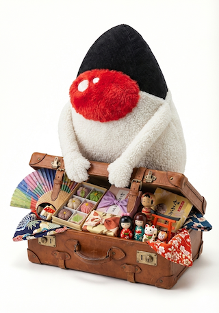

[](https://jitpack.io/#umjammer/jlha)
[](https://github.com/umjammer/jlha/actions/workflows/maven.yml)
[](https://github.com/umjammer/jlha/actions/workflows/codeql-analysis.yml)

[](https://github.com/umjammer/vavi-util-archive)

# LHA for Java



🗜️LHA compatible archiving library works with Java.

## Install

https://jitpack.io/#umjammer/jlha

## Usage

```java
    LhaFile file = new LhaFile(Paths.get("src/test/resources/test.lzh").toFile());
    Path outDir = Paths.("/foo/bar");
    for (LhaHeader header : file.getEntries()) {
        Files.copy(file.getInputStream(header), Files.newOutputStream(outDir.resolve(header.getPath())));
    }
```

## References

- [original](https://web.archive.org/web/20170909125843/http://dangan.g.dgdg.jp/)

## TODO

- ~~unit tests~~

---

<sub>image designed by @umjammer, drawn by nano banana</sub>
